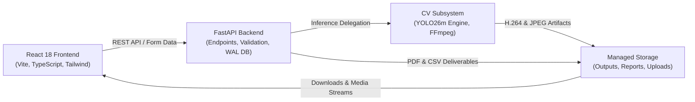

# RoadVision — Intelligent Road Monitoring System

[](docs/INSTALLATION.md)
[](https://www.python.org/)
[](https://fastapi.tiangolo.com/)
[](https://react.dev/)
[](models/weights/yolo26m.pt)
[](docs/INSTALLATION.md)

**RoadVision** is an end-to-end intelligent road infrastructure monitoring and defect detection platform. Powered by a custom-trained deep learning model (**YOLO26m**), RoadVision detects, categorizes, and tracks road surface degradation across static photographs, recorded road inspection videos, and real-time camera streams.

---

## Table of Contents
1. [Core Features](#1-core-features)
2. [Supported Road Damage Classes](#2-supported-road-damage-classes)
3. [Architecture Overview](#3-architecture-overview)
4. [Hardware & Compatibility Profile](#4-hardware--compatibility-profile)
5. [Quick Start (Local Development)](#5-quick-start-local-development)
6. [Docker & Containerization](#6-docker--containerization)
7. [Automated Inspection Reports & Data Export](#7-automated-inspection-reports--data-export)
8. [Upload Limits & Security Safeguards](#8-upload-limits--security-safeguards)
9. [Automated Testing Baseline](#9-automated-testing-baseline)
10. [Model Verification & Checksums](#10-model-verification--checksums)
11. [Documentation Index](#11-documentation-index)
12. [Project Contributors](#12-project-contributors)

---

## 1. Core Features

- **Static Image Inspection**: Synchronous defect detection on high-resolution photographs with interactive bounding-box overlays, class tags, and confidence scores.
- **Asynchronous Video Processing**: Frame-by-frame defect inference on recorded roadway videos transcoded to H.264 MP4 with persistent progress polling.
- **Real-Time Live Camera**: DirectShow webcam capture pipeline with synchronized MJPEG frame streaming and hardware lifecycle management.
- **Persisted Inspection History**: Full audit trail stored in SQLite using Write-Ahead Logging (WAL) mode for concurrency.
- **Automated PDF Reports**: High-quality printable PDF inspection reports with defect statistics, metadata summaries, and embedded visual evidence.
- **Bulk CSV Data Export**: Tabular export of historical inspection records formatted for municipal asset management.
- **Dynamic Hardware Resolution**: Automatically detects NVIDIA GPUs (CUDA) with seamless fallback to CPU inference on non-accelerated systems.

---

## 2. Supported Road Damage Classes

Trained on the Road Damage Dataset (RDD2022) with four normalized target categories:

| Class Code | Class Name | Category | Primary Visual Characteristics |
|---|---|---|---|
| **D00** | Longitudinal Crack | Surface Crack | Cracks propagating parallel to the direction of travel |
| **D10** | Transverse Crack | Surface Crack | Cracks propagating perpendicular to the lane line |
| **D20** | Alligator Crack | Surface Crack | Interconnected polygonal fatigue crack networks |
| **D40** | Pothole | Structural Defect | Bowl-shaped depressions and structural pavement cavities |

---

## 3. Architecture Overview



---

## 4. Hardware & Compatibility Profile

| Hardware Tier | Compute Mode | Expected Performance |
|---|---|---|
| **NVIDIA RTX Series (Laptop / Desktop)** | CUDA 12.x GPU Acceleration | **14–25 ms / image**, **~30–40 FPS video transcode** |
| **Multi-Core x86_64 CPU** | CPU Inference Fallback | **120–250 ms / image**, **4–8 FPS video transcode** |
| **Apple Silicon (macOS)** | CPU / MPS Inference | **80–180 ms / image** |

---

## 5. Quick Start (Local Development)

### Prerequisites
- Python 3.10–3.12 (Tested on 3.11.9)
- Node.js v18+ & npm (Tested on Node v24.x)
- FFmpeg installed and in system `PATH`
- Git

### Step 1: Clone Repository
```bash
git clone https://github.com/RamSamhith/roadvision_ai.git
cd roadvision_ai
```

### Step 2: Set Up Backend Environment
```powershell
# Create and activate virtual environment (Windows PowerShell)
python -m venv .venv
.\.venv\Scripts\Activate.ps1

# Upgrade pip and install pinned requirements
python -m pip install --upgrade pip
pip install -r backend/requirements.txt
```

### Step 3: Install Frontend Dependencies & Build
```powershell
cd frontend
npm install
npm run build
cd ..
```

### Step 4: Verify Model Weight Integrity
```powershell
Get-FileHash -Algorithm SHA256 models\weights\yolo26m.pt
# Expected: 1BC41287DBDBC5EC5793D5D8F14CBA770E9E71E9C9E0CC0188B7146DA592D233
```

### Step 5: Launch Application
Open two separate terminal windows:

- **Terminal 1 (Backend API)**:
  ```powershell
  $env:PYTHONPATH="backend"
  .\.venv\Scripts\python.exe -m uvicorn app.main:app --host 127.0.0.1 --port 8000 --reload
  ```
- **Terminal 2 (Frontend UI)**:
  ```powershell
  cd frontend
  npm run dev
  ```

Open your browser to: **`http://localhost:5173`**
Interactive API Docs (Swagger UI): **`http://127.0.0.1:8000/docs`**

---

## 6. Docker & Containerization

The repository provides a complete `Dockerfile` and `docker-compose.yml` for containerized environments:

```bash
docker compose up --build
```
*Note: Docker configurations are syntactically standard; local host verification during development was conducted on bare-metal Windows 11 with the native Python virtual environment.*

---

## 7. Automated Inspection Reports & Data Export

RoadVision enables one-click generation of professional PDF reports and CSV datasets:
- **PDF Report**: `GET /api/v1/reports/pdf/{id}` — Generates a formal, printable inspection document including defect breakdown tables, session telemetry, and embedded damage imagery.
- **CSV Export**: `GET /api/v1/reports/csv` — Exports comprehensive tabular audit logs for spreadsheets and municipal GIS databases.

---

## 8. Upload Limits & Security Safeguards

- **Max Image Size**: 15 MB (`.jpg`, `.jpeg`, `.png`, `.webp`), validated via binary magic bytes.
- **Max Image Dimensions**: 4096 × 4096 px.
- **Max Video Size**: 100 MB (`.mp4`, `.avi`, `.mov`), maximum 180 seconds duration.
- **Path Traversal Protection**: All file lookups enforce strict UUID validation with isolated storage directories.
- **Concurrency Guard**: Singleton `JobSlot` lock prevents memory starvation by restricting concurrent video/camera jobs to 1 at a time.

---

## 9. Automated Testing Baseline

The repository includes a comprehensive automated test suite covering all CV pipelines, API controllers, reports, and security constraints:

```powershell
.\.venv\Scripts\python.exe -m pytest -o pythonpath=backend backend/tests/ -v
```
**Current Automated Test Status: 165 Passed, 0 Failed.**

---

## 10. Model Verification & Checksums

| Attribute | Specification |
|---|---|
| **Model Architecture** | YOLO26m (Medium Variant) |
| **Model Weight Path** | `models/weights/yolo26m.pt` |
| **File Size** | 41.99 MB (44,034,229 bytes) |
| **SHA-256 Hash** | `1BC41287DBDBC5EC5793D5D8F14CBA770E9E71E9C9E0CC0188B7146DA592D233` |
| **Trained Classes** | `0: D00`, `1: D10`, `2: D20`, `3: D40` |

---

## 11. Documentation Index

- **[Master Project Guide & Technical Manual](docs/ROADVISION_COMPLETE_PROJECT_GUIDE.md)** — Comprehensive technical manual (Parts A–P).
- **[College Viva Voce & Technical Defense Guide](docs/ROADVISION_VIVA_PREPARATION.md)** — Complete 125-question viva preparation guide with pitch scripts.
- **[System Architecture Reference](docs/ARCHITECTURE.md)** — Deep dive into components and data flows.
- **[Cross-Platform Installation Guide](docs/INSTALLATION.md)** — Detailed setup and troubleshooting.
- **[Report Generation Specification](docs/REPORT_GENERATION.md)** — PDF and CSV design details.
- **[Upload Limits & Security Policies](docs/UPLOAD_LIMITS.md)** — Input constraints and security mechanisms.

---

## 12. Project Contributors

- **Ram Samhith** — Computer Vision, Model Integration & Inference, Confidence Calibration, AI Pipeline Architecture.
- **Shaik Shakeeb** — Backend Application Architecture, Database & REST API, Video Worker Orchestration, React Frontend UI.

---

## License

This project is developed for educational, academic, and research purposes under the RoadVision Intelligent Road Monitoring initiative.
