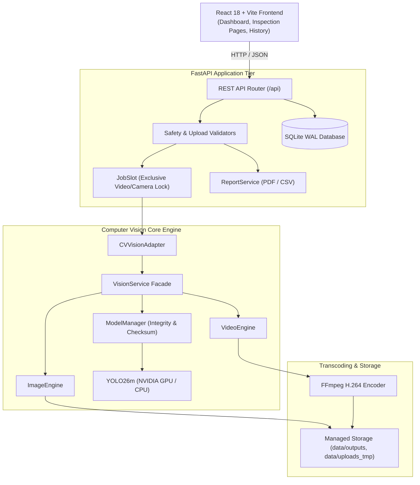

# RoadVision — Comprehensive Architecture Guide

RoadVision is a modular, high-performance intelligent roadway inspection system combining YOLO deep learning with modern web architecture.

---

## 1. System Architecture Overview



---

## 2. Directory Layout

```
roadvision_ai/
├── backend/
│   ├── app/
│   │   ├── api/
│   │   │   ├── routes/       # FastAPI route controllers (image, video, camera, dashboard, reports, etc.)
│   │   │   └── inspection_responses.py
│   │   ├── database/         # SQLite schema and data access operations
│   │   ├── services/
│   │   │   ├── cv_adapter.py # Direct bridge to Computer Vision core
│   │   │   ├── vision/       # Primary CV engine (ImageEngine, VideoEngine, ModelManager)
│   │   │   ├── camera_service.py # DirectShow webcam capture & MJPEG streaming
│   │   │   ├── ffmpeg_service.py # H.264 transcode pipeline
│   │   │   ├── file_service.py   # Safe uploads & path traversal validation
│   │   │   └── report_service.py # ReportLab PDF and CSV generation
│   │   ├── config.py         # Consolidated application settings
│   │   ├── errors.py         # Standardized JSON API exception handling
│   │   └── main.py           # FastAPI application factory and lifespan hooks
│   ├── tests/                # Automated pytest suite (165 tests)
│   └── requirements.txt      # Pinned Python package dependencies
├── frontend/
│   ├── src/
│   │   ├── app/              # Router and App container
│   │   ├── components/       # Reusable layout and UI elements
│   │   ├── pages/            # Dashboard, ImageDetection, VideoDetection, LiveCamera, History
│   │   └── services/         # Typed API clients
│   ├── package.json          # Frontend dependencies (React 18, Vite, Tailwind CSS)
│   └── vite.config.ts        # Vite configuration & /api proxy
├── models/
│   └── weights/              # Production YOLO26m model weights (.pt)
├── data/                     # Local storage (db, outputs, uploads_tmp, logs)
├── docs/                     # Engineering specifications & setup guides
├── Dockerfile                # Multi-stage production container
└── docker-compose.yml        # Multi-container orchestration
```

