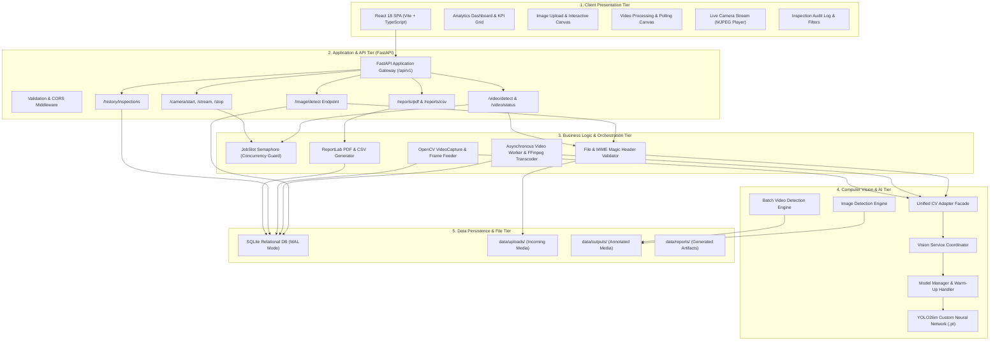
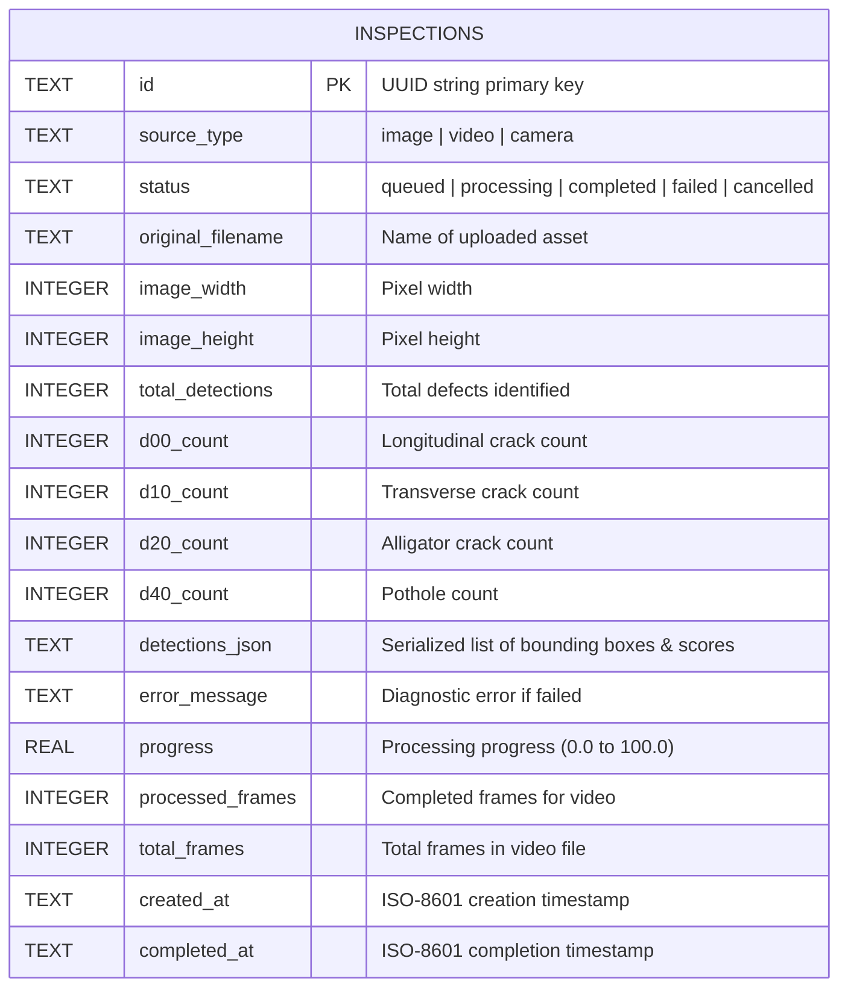

# RoadVision — Complete Project Guide & Technical Manual

**Project Name:** RoadVision – Intelligent Road Monitoring System  
**Repository:** `https://github.com/RamSamhith/roadvision_ai`  
**Target Audience:** Students, Developers, Technical Reviewers, Project Evaluators, and Engineering Teams  
**Document Status:** Complete & Verified Technical Specification  

---

## Table of Contents

1. [Part A — Project Fundamentals](#part-a--project-fundamentals)
2. [Part B — Road Damage Understanding](#part-b--road-damage-understanding)
3. [Part C — Complete System Architecture](#part-c--complete-system-architecture)
4. [Part D — Complete Execution Workflow](#part-d--complete-execution-workflow)
5. [Part E — Complete Technology Stack](#part-e--complete-technology-stack)
6. [Part F — AI and Object Detection Deep Dive](#part-f--ai-and-object-detection-deep-dive)
7. [Part G — Backend and API Architecture](#part-g--backend-and-api-architecture)
8. [Part H — Frontend User Interface](#part-h--frontend-user-interface)
9. [Part I — Database and Storage Architecture](#part-i--database-and-storage-architecture)
10. [Part J — Security, Validation, and Reliability](#part-j--security-validation-and-reliability)
11. [Part K — Automated Reports and Data Export](#part-k--automated-reports-and-data-export)
12. [Part L — Installation and Execution Guide](#part-l--installation-and-execution-guide)
13. [Part M — Repository and Project Structure](#part-m--repository-and-project-structure)
14. [Part N — Engineering Challenges and Decisions](#part-n--engineering-challenges-and-decisions)
15. [Part O — Limitations and Future Scope](#part-o--limitations-and-future-scope)
16. [Part P — Conclusion](#part-p--conclusion)

---

## Part A — Project Fundamentals

### 1. What is RoadVision?
**RoadVision** is an automated, artificial intelligence-powered road monitoring system designed to inspect, detect, classify, and record roadway surface damage in real time. Instead of requiring municipal workers to drive slowly and manually record road cracks on paper forms, RoadVision accepts photographs, recorded road inspection videos, and live camera feeds, applies deep learning computer vision algorithms, and outputs precise defect locations, severity classifications, interactive visual maps, and downloadable compliance reports.

### 2. What Real-World Problem Does It Solve?
Every country in the world depends on road infrastructure for transportation, commerce, and public safety. However, asphalt roads deteriorate continuously due to heavy vehicular traffic, rainwater penetration, thermal expansion, freezing temperatures, and aging binder materials. 

When a minor surface crack forms, water seeps beneath the road surface. In winter, this water freezes and expands; in summer, vehicular weight forces the weakened foundation to collapse, turning a hairline crack into a deep, hazardous pothole within weeks. 

Traditional road maintenance is **reactive**—repairs only happen after motorists file complaints or accidents occur. RoadVision solves this by making road monitoring **preventative and continuous**. It detects defects early, allowing transportation authorities to seal minor cracks before they become expensive potholes.

### 3. Why is Road Damage Detection Important?
- **Public Safety:** Unmarked potholes and severe cracks cause vehicular loss of control, tire blowouts, wheel rim damage, and fatal two-wheeler accidents.
- **Economic Cost:** Vehicle repairs caused by poor road surfaces cost motorists billions of dollars annually. Furthermore, repairing a pothole or rebuilding a collapsed sub-base is up to **10 to 30 times more expensive** than sealing an early-stage crack.
- **Government Accountability:** Municipal bodies need verifiable, audit-trailed inspection data to prioritize road repair budgets efficiently and verify contractor quality.

### 4. What Are the Limitations of Manual Road Inspection?
1. **Slow and Labor-Intensive:** Inspection crews can only survey a few kilometers of roadway per shift.
2. **Subjective and Inconsistent:** Different human inspectors rate crack severity differently; what one inspector classifies as minor, another records as severe.
3. **Dangerous for Personnel:** Surveyors must walk or drive slowly along high-speed highways and busy arterial roads, exposing themselves to traffic hazards.
4. **Poor Auditability:** Paper records and unindexed photo dumps lack georeferencing, standardized bounding boxes, and timestamped database queries.
5. **High Operational Expense:** Maintaining dedicated physical survey crews throughout the year places a heavy burden on municipal budgets.

### 5. What is Computer Vision?
**Computer Vision (CV)** is a scientific discipline within Artificial Intelligence that trains computers to interpret and understand the visual world. Using digital images and video sequences, computer vision systems extract pixel data, recognize edges, textures, and geometric shapes, and make high-level decisions such as identifying objects, measuring distances, and tracking motion.

### 6. What is Artificial Intelligence?
**Artificial Intelligence (AI)** refers to computer systems designed to perform cognitive tasks typically associated with human intelligence, such as visual perception, pattern recognition, learning from past experience, and data-driven decision making.

### 7. What is Deep Learning?
**Deep Learning (DL)** is a specialized sub-branch of Machine Learning based on Artificial Neural Networks with multiple processing layers (hence "deep"). Unlike traditional algorithms where software engineers must manually write mathematical rules for every feature (e.g., "a crack is a dark line of pixels with gradient higher than X"), deep neural networks learn these features automatically by analyzing tens of thousands of labeled training examples.

### 8. What is Object Detection?
To understand object detection, it helps to distinguish three related computer vision tasks:
- **Image Classification:** Answering "What is this image of?" (e.g., "This image contains a road").
- **Object Localization:** Answering "Where is the primary object located?" (drawing one box around a single object).
- **Object Detection:** Answering both questions simultaneously for **multiple objects of different categories** across a single scene (e.g., "There is a Longitudinal Crack at `[x1, y1, x2, y2]` with 91% confidence, and a Pothole at `[x3, y3, x4, y4]` with 84% confidence").

### 9. How Does RoadVision Use These Technologies?
RoadVision captures raw visual input (from file uploads or cameras), preprocesses the imagery, feeds the matrix of normalized pixel values into a trained **YOLO26m** deep neural network, predicts defect bounding boxes and confidence scores, persists the structured metadata into a relational database, and renders interactive visual analytics on a modern web dashboard.

### 10. Objectives and Expected Outcomes
- **Zero-Install Web Usability:** Inspectors can upload images or monitor streams directly in a web browser without installing specialized computer vision tools.
- **High Detection Accuracy:** Identify four major pavement defect categories with high recall and precision.
- **Hardware Portability:** Run smoothly on high-performance NVIDIA GPUs while seamlessly falling back to standard multicore CPUs on office laptops.
- **Standardized Reporting:** Instantly generate printable PDF audit reports and CSV tabular exports for municipal decision-makers.

---

## Part B — Road Damage Understanding

RoadVision is trained to recognize the four standard pavement defect classes defined by the international Road Damage Dataset (RDD) benchmark:

```
+---------------------------------------------------------------------------------+
|                               ROAD DAMAGE TAXONOMY                              |
+----------------------+--------------------+-------------------+-----------------+
| D00: Longitudinal    | D10: Transverse    | D20: Alligator    | D40: Pothole    |
| Parallel to lane     | Across lane        | Interconnected    | Bowl depression |
| (Surface crack)      | (Surface crack)    | (Fatigue crack)   | (Cavity defect) |
+----------------------+--------------------+-------------------+-----------------+
```

### 1. D00 — Longitudinal Crack
- **Visual Appearance:** Linear cracks running parallel to the direction of vehicle travel (along the length of the road).
- **Primary Causes:** Poor lane-joint construction, reflective cracking from underlying concrete pavement slabs, or localized pavement fatigue under repetitive wheel path loads.
- **Hazard Level:** Medium. If unsealed, surface water penetrates the joint, accelerating subgrade softening and lane edge degradation.
- **Detection in RoadVision:** Identified as class `0` / `D00` with high aspect-ratio vertical bounding boxes.

### 2. D10 — Transverse Crack
- **Visual Appearance:** Linear cracks running perpendicular (across) the direction of vehicle travel.
- **Primary Causes:** Thermal shrinkage of the asphalt binder during sudden cold temperature drops, or daily thermal contraction/expansion cycles.
- **Hazard Level:** Medium. As vehicles drive over transverse cracks, repetitive impact causes the edges to crumble ("spalling"), creating annoying bumps for drivers.
- **Detection in RoadVision:** Identified as class `1` / `D10` with horizontal, wide aspect-ratio bounding boxes.

### 3. D20 — Alligator Crack (Fatigue Cracking)
- **Visual Appearance:** A complex, interconnected network of multi-sided polygonal cracks that closely resembles the scaly pattern of alligator or crocodile skin.
- **Primary Causes:** Structural failure of the road base or subgrade under repetitive, excessive heavy axle loads. It indicates that the pavement foundation has lost its load-bearing capacity.
- **Hazard Level:** High. Alligator cracking is a late-stage structural warning. Without intervention, the loose asphalt blocks dislodge completely, rapidly forming potholes.
- **Detection in RoadVision:** Identified as class `2` / `D20` spanning clustered crack grids.

### 4. D40 — Pothole
- **Visual Appearance:** Bowl-shaped depressions, structural cavities, or holes in the pavement surface with steep, broken edges, exposing the coarse gravel or base layer beneath.
- **Primary Causes:** Late-stage failure resulting from unsealed cracks. Water freezes and thaws beneath the surface, weakening the foundation; heavy traffic then hammers the unsupported asphalt, causing chunks to break free and get ejected by vehicle tires.
- **Hazard Level:** Critical. Potholes cause immediate tire punctures, broken suspension springs, wheel alignment failure, and severe accidents if vehicles swerve abruptly to avoid them.
- **Detection in RoadVision:** Identified as class `3` / `D40` with localized bounding contours around the depression perimeter.

### Normalization Mapping Table
| Class Code | Full Label Name | Category | Primary Detection Indicator |
|---|---|---|---|
| **D00** | Longitudinal Crack | Surface Crack | Long vertical crack path |
| **D10** | Transverse Crack | Surface Crack | Wide horizontal crack path |
| **D20** | Alligator Crack | Structural Fatigue | Hexagonal/polygonal mesh pattern |
| **D40** | Pothole | Structural Cavity | Dark cavity with defined perimeter |

---

## Part C — Complete System Architecture

RoadVision is designed as a decoupled, multi-tier system separating client presentation, REST API orchestration, deep learning inference, and persistent data storage.

### High-Level Architecture Diagram



### Component Responsibility Breakdown

1. **Client Tier (Frontend):** Built with React 18 and Vite. It provides an intuitive user experience with immediate visual feedback, client-side bounding box rendering, progress bars for asynchronous video rendering, and one-click PDF/CSV report downloads.
2. **Application Tier (Backend API):** Built with FastAPI and Uvicorn. It enforces strict HTTP input validation, verifies file signatures using magic bytes, manages long-running background tasks, and provides RESTful endpoints.
3. **Orchestration Tier:** Manages concurrent resource usage via a singleton `JobSlot` locking mechanism (ensuring that video transcoding and live camera sessions do not collide), orchestrates OpenCV frame capture, and delegates rendering to FFmpeg.
4. **Computer Vision Tier:** Encapsulates the PyTorch deep learning pipeline. It handles dynamic device resolution (CUDA GPU vs CPU), loads model weights with SHA-256 verification, preprocesses images (resizing, normalization), executes model forward passes, and applies confidence calibration.
5. **Storage Tier:** Retains structured inspection records inside a thread-safe SQLite database configured in Write-Ahead Logging (WAL) mode, while physical media files are organized in managed directories (`uploads/`, `outputs/`, `reports/`).

---

## Part D — Complete Execution Workflow

### 1. Static Image Inspection Flow
```
User selects image in UI
       ↓
Browser sends multipart/form-data to POST /api/v1/image/detect
       ↓
FastAPI streams file to memory/disk buffer
       ↓
FileValidator checks:
  - File size (<= 15 MB)
  - Magic bytes (JPEG, PNG, WebP)
  - Dimensions (<= 4096 x 4096)
       ↓
VisionService decodes bytes into OpenCV BGR numpy array
       ↓
ModelManager executes YOLO26m inference on active device (CUDA/CPU)
       ↓
ImageEngine parses detections, computes bounding boxes, applies confidence calibration
       ↓
ImageEngine draws colored bounding boxes and labels on output image
       ↓
Inspection record saved to SQLite (id, filename, counts, detections JSON)
       ↓
Annotated image written to data/outputs/{id}_annotated.jpg
       ↓
JSON response returned to browser with detection summary and coordinates
       ↓
Frontend renders image canvas with highlighted defect tags
```

### 2. Video Inspection Flow (Asynchronous Job Queue)
Because video processing requires evaluating hundreds or thousands of individual frames, RoadVision processes videos **asynchronously** to prevent HTTP request timeouts:
1. **Upload & Enqueue:** The user uploads a video file (MP4, AVI, MOV up to 100 MB). The API validates duration (max 180 seconds) and resolution (max 1920x1080), creates an inspection record in `queued` status, and returns HTTP 202 Accepted with a unique `job_id`.
2. **Resource Lock:** The background worker acquires the exclusive `JobSlot` lock to guarantee that no competing heavy task exhausts system RAM or GPU memory.
3. **Frame-by-Frame Inference:** OpenCV decodes frames sequentially. The vision engine batches frames, runs YOLO26m inference, draws bounding boxes on defect-containing frames, and logs detection timestamps.
4. **Transcoding & Remuxing:** Transcoded frames are passed to an FFmpeg subprocess that encodes an optimized, web-playable H.264 MP4 with fast-start flags.
5. **Progress Polling:** The client frontend polls `GET /api/v1/video/status/{job_id}` every 1–2 seconds. The server responds with progress percentage (`progress: 45.2%`, `processed_frames: 450`, `total_frames: 1000`).
6. **Completion:** Upon reaching 100%, the job status transitions to `completed`. The browser automatically switches from the progress bar to the HTML5 video player, loading the annotated video from `/api/v1/results/video/{job_id}`.

### 3. Live Camera Streaming Flow
1. **Session Start:** The user navigates to the Live Camera page and clicks "Start Camera". A request is dispatched to `POST /api/v1/camera/start`.
2. **Hardware Acquisition:** The backend initializes the OpenCV `VideoCapture` pipeline targeting the selected DirectShow camera index.
3. **MJPEG Stream Generator:** A dedicated streaming generator reads frames in real time, executes YOLO26m inference, overlays defect bounding boxes, and encodes the annotated frame as JPEG bytes.
4. **Multipart HTTP Streaming:** The browser opens `GET /api/v1/camera/stream` inside an standard `` tag. The server delivers the continuous stream using HTTP `multipart/x-mixed-replace; boundary=frame`.
5. **Watchdog & Session End:** A built-in watchdog timer enforces a 300-second maximum session cap. When the user clicks "Stop" or the watchdog triggers, the hardware camera device is released immediately, and aggregate session statistics are committed to SQLite.

---

## Part E — Complete Technology Stack

The following table documents every technology genuinely implemented in the RoadVision repository:

| Technology | Category | Purpose | Why It Was Selected | Where Used in Codebase |
|---|---|---|---|---|
| **Python 3.11** | Runtime | Core backend & AI language | Optimal balance of speed, stable PyTorch support, and async syntax | Entire backend and CV pipeline |
| **FastAPI (0.115+)** | Web Framework | REST API gateway | High performance (ASGI), automatic OpenAPI schemas, native Pydantic validation | `backend/app/main.py`, `backend/app/api/` |
| **Uvicorn** | ASGI Server | Async HTTP server | Lightweight, high-throughput asynchronous request handling | Web server runner (`uvicorn app.main:app`) |
| **PyTorch (2.11.0+cu128)** | ML Framework | Deep learning tensor engine | Industry standard for computer vision research and production deployment | Model weight execution & GPU tensor ops |
| **Ultralytics YOLO** | CV Library | Model architecture & forward pass | High-speed, battle-tested modern object detection implementation | `backend/app/services/vision/model_manager.py` |
| **YOLO26m** | Model | Road damage detection | Medium parameter size (41.99 MB) balancing high mAP and real-time inference | `models/weights/yolo26m.pt` |
| **OpenCV (cv2)** | CV Library | Image & video decoding/encoding | Fast C++ image manipulation, matrix math, color space conversion, bounding box drawing | `backend/app/services/vision/`, `camera_service.py` |
| **FFmpeg (v9.0)** | Media Utility | Video encoding & transcoding | Flawless H.264 MP4 generation with web-compatible profiles | `backend/app/services/ffmpeg_service.py` |
| **SQLite (3.x)** | Database | Relational metadata persistence | Zero-configuration, serverless, self-contained, ACID-compliant storage | `backend/app/database/`, `data/db/roadvision.sqlite3` |
| **ReportLab** | Document Gen | Printable PDF report synthesis | Programmatic PDF composition with tables, styled paragraphs, and dynamic image insertion | `backend/app/services/report_service.py` |
| **React (18.3)** | Frontend Library | Component-based user interface | Declarative UI, virtual DOM diffing, massive community ecosystem | `frontend/src/` |
| **TypeScript (5.5)** | Language | Static type safety for frontend | Eliminates runtime property errors, provides complete API contract interfaces | Entire `frontend/src/` |
| **Vite (5.4)** | Build Tool | Frontend bundling & HMR | Instant development server startup, optimized tree-shaken production bundles | `frontend/vite.config.ts` |
| **Tailwind CSS (3.4)** | Styling | Responsive CSS styling | Utility-first CSS providing clean, consistent dark-mode UI styling | `frontend/tailwind.config.js`, `globals.css` |
| **Lucide React** | UI Icons | Modern vector iconography | Lightweight, accessible SVG icon set | Frontend UI navigation and status indicators |
| **Pytest** | Testing | Automated backend testing | Robust fixture system, parameterized test runner, clean test discovery | `backend/tests/` (165 passing tests) |
| **Docker & Compose** | Containerization | Deployment specification | Reproducible multi-container orchestration (configured and documented) | `Dockerfile`, `docker-compose.yml` |

---

## Part F — AI and Object Detection Deep Dive

### 1. Neural Networks & Convolutional Layers
Traditional computer software operates on explicit mathematical logic (e.g., `if pixel > 120`). However, road cracks appear in infinitely diverse lighting conditions, angles, and surface textures. 

A **Convolutional Neural Network (CNN)** processes images by sliding mathematical matrices (called kernels or filters) across the pixel grid. Early layers detect primitive visual features (vertical edges, horizontal borders, color transitions). Middle layers combine edges into textures (rough asphalt, linear lines). Deep layers synthesize these patterns into semantic concepts (a jagged crack propagating across a lane).

### 2. The YOLO (You Only Look Once) Paradigm
Earlier object detection systems (such as R-CNN and Faster R-CNN) used a two-stage approach:
1. Propose candidate regions of interest in the image.
2. Run a classifier on each candidate box.

This two-stage process was computationally slow (frequently below 5 frames per second). **YOLO** revolutionized computer vision by reframing detection as a **single regression problem**. YOLO feeds the entire image through the neural network in a single forward pass, predicting both bounding box coordinates and class probabilities simultaneously across all grid cells. This enables real-time inference (30–60+ FPS on modern GPUs).

### 3. YOLO26m: The Production Model
The model deployed in RoadVision is **YOLO26m** (`models/weights/yolo26m.pt`, file size: **41.99 MB**, SHA-256: `1BC41287DBDBC5EC5793D5D8F14CBA770E9E71E9C9E0CC0188B7146DA592D233`).
- **Parameter Capacity:** The "m" designation denotes a **Medium** architecture variant, providing significantly higher feature discrimination for subtle asphalt cracks than lightweight nano ("n") models, while remaining compact enough to run comfortably in 8 GB VRAM.
- **Trained Classes:** Exactly four road defect classes: `0: D00`, `1: D10`, `2: D20`, `3: D40`.
- **Pretrained vs Custom Trained:** While standard YOLO models are trained on common everyday objects (people, dogs, cars, bicycles), RoadVision's weights have been custom-trained on road damage imagery, optimizing the convolutional weights specifically for pavement texture degradation.

### 4. Bounding Box Geometry & Coordinates
A bounding box is a rectangular envelope enclosing a detected defect. YOLO predicts coordinates normalized between `0.0` and `1.0`:
$$\text{Box} = [x_{\text{center}}, y_{\text{center}}, \text{width}, \text{height}]$$
RoadVision's vision engine converts these normalized predictions into absolute pixel coordinates for the original image dimensions:
$$x_{\min} = \lfloor(x_{\text{center}} - \frac{\text{width}}{2}) \times W_{\text{orig}}\rfloor$$
$$y_{\min} = \lfloor(y_{\text{center}} - \frac{\text{height}}{2}) \times H_{\text{orig}}\rfloor$$
$$x_{\max} = \lfloor(x_{\text{center}} + \frac{\text{width}}{2}) \times W_{\text{orig}}\rfloor$$
$$y_{\max} = \lfloor(y_{\text{center}} + \frac{\text{height}}{2}) \times H_{\text{orig}}\rfloor$$

### 5. Intersection over Union (IoU) & Non-Maximum Suppression (NMS)
During a single forward pass, the model may predict several slightly overlapping boxes for the same physical pothole. 
- **Intersection over Union (IoU):** Measures the overlap between two bounding boxes:
  $$\text{IoU} = \frac{\text{Area of Overlap}}{\text{Area of Union}}$$
- **Non-Maximum Suppression (NMS):** Eliminates duplicate detections:
  1. Sort all predicted boxes by confidence score.
  2. Select the box with the highest confidence.
  3. Discard any remaining box that has an $\text{IoU} > 0.45$ with the selected box.
  4. Repeat until all overlapping duplicates are pruned.

### 6. Confidence Calibration: Balanced vs High-Recall Modes
In real-world road surveys, user requirements vary:
- **Balanced Mode (Threshold = 0.25):** The production default. It filters out faint road shadows, oil stains, and tire skid marks, ensuring that reported defects have high statistical confidence.
- **High-Recall Mode (Threshold = 0.15):** A sensitivity mode tailored for early-stage maintenance surveys. It lowers the confidence threshold to capture faint hairline cracks that are just beginning to form, accepting a slightly higher rate of manual verification in exchange for zero missed defects.

---

## Part G — Backend and API Architecture

FastAPI acts as the central orchestration nervous system of RoadVision. It receives HTTP requests from the browser, performs rigorous validation, coordinates the vision engine, and handles database operations.

### REST API Endpoint Reference Table

| Method | Path | Summary / Purpose | Request Input | Response Output | Status Codes |
|---|---|---|---|---|---|
| `GET` | `/api/v1/health` | System health & model status | None | JSON with service status, active device, and model loaded state | `200` |
| `POST` | `/api/v1/image/detect` | Synchronous static image defect detection | Multipart form: `file` (image binary), `confidence` (float/string) | JSON containing defect list, bounding boxes, counts, and output image URL | `200`, `400`, `413`, `415`, `422`, `503` |
| `POST` | `/api/v1/video/detect` | Asynchronous video inspection enqueue | Multipart form: `file` (video binary), `confidence` | JSON with assigned `job_id`, initial `status: queued` | `202`, `400`, `409`, `413`, `415`, `422` |
| `GET` | `/api/v1/video/status/{id}`| Poll progress of a video processing job | Path parameter: `id` (inspection UUID) | JSON with progress percentage, frame count, status, and summary | `200`, `404` |
| `POST` | `/api/v1/video/cancel/{id}`| Abort an ongoing video processing job | Path parameter: `id` | JSON confirming cancellation and cleanup | `200`, `400`, `404` |
| `POST` | `/api/v1/camera/start` | Initialize live webcam capture session | Query params: `camera_index`, `confidence` | JSON with new `inspection_id`, `status: processing` | `200`, `409`, `422`, `503` |
| `GET` | `/api/v1/camera/stream` | Continuous MJPEG stream of annotated camera frames | None (active session required) | HTTP `multipart/x-mixed-replace` image stream | `200`, `409` |
| `POST` | `/api/v1/camera/stop` | Terminate live camera session & save stats | None | JSON with finalized defect counts and session summary | `200`, `409` |
| `GET` | `/api/v1/history/inspections` | Query historical inspection audit trail | Query params: `limit`, `offset`, `source_type` | JSON list of past inspections with defect counts and timestamps | `200` |
| `GET` | `/api/v1/results/image/{id}`| Retrieve annotated output photograph | Path parameter: `id` | Raw JPEG image binary (`image/jpeg`) | `200`, `404` |
| `GET` | `/api/v1/results/video/{id}`| Stream annotated output video | Path parameter: `id` | Streamed H.264 MP4 video (`video/mp4`) | `200`, `404` |
| `GET` | `/api/v1/reports/pdf/{id}` | Download formal PDF inspection audit report | Path parameter: `id` | Binary PDF document (`application/pdf`) | `200`, `404` |
| `GET` | `/api/v1/reports/csv` | Download complete inspection history as CSV | Query filters | Tabular CSV file (`text/csv`) | `200` |
| `GET` | `/api/v1/dashboard/kpis` | High-level metrics for dashboard cards | None | JSON with total inspections, total defects, class distributions | `200` |

---

## Part H — Frontend User Interface

The RoadVision frontend is an interactive Single Page Application (SPA) built using React 18, TypeScript, and Vite.

```
+------------------------------------------------------------------------------------+
|                               ROADVISION WEB DASHBOARD                             |
+------------------------------------------------------------------------------------+
| [Logo] RoadVision AI    | Dashboard | Image Detect | Video Detect | Live Camera |  |
+------------------------------------------------------------------------------------+
|  +--------------------+  +--------------------+  +-------------------------------+ |
|  | Total Inspections  |  | Total Defects      |  | System Health: ONLINE (CUDA)  | |
|  | 142 Completed      |  | 384 Detected       |  | Model: YOLO26m (Verified)     | |
|  +--------------------+  +--------------------+  +-------------------------------+ |
|                                                                                    |
|  [ Upload Road Photograph (Drag & Drop) ]                                          |
|  Selected: highway_mile42.jpg (1920x1080)                                         |
|  [ Slider: Confidence Threshold (0.25) ]  [ Mode: Balanced v ]  [ Run Inspection ] |
|                                                                                    |
|  +---------------------------------------+  +------------------------------------+ |
|  | Display Canvas                        |  | Inspection Summary                 | |
|  | +-----------------------------------+ |  | File: highway_mile42.jpg           | |
|  | | [D40 Pothole (0.88)]              | |  | Defects Found: 3                   | |
|  | | +-------------------------------+ | |  | - D00 Longitudinal Crack: 1       | |
|  | | |                               | | |  | - D40 Pothole: 2                   | |
|  | | +-------------------------------+ | |  | Inference Time: 22.5 ms (CUDA)     | |
|  | +-----------------------------------+ |  | [ Download PDF ] [ Export CSV ]    | |
|  +---------------------------------------+  +------------------------------------+ |
+------------------------------------------------------------------------------------+
```

### Dedicated Pages & Features
1. **Analytics Dashboard (`DashboardPage.tsx`):** Displays aggregated metrics (KPI cards for total inspections, defect category distributions, recent activity logs, and system hardware status).
2. **Image Detection Page (`ImageDetectionPage.tsx`):** Provides drag-and-drop file upload, confidence slider adjustment, real-time bounding box overlay rendering, defect categorization chips, and instant PDF report download buttons.
3. **Video Detection Page (`VideoDetectionPage.tsx`):** Accepts MP4/MOV uploads, manages asynchronous task polling with smooth progress indicators, and transitions to an interactive HTML5 video player upon completion.
4. **Live Camera Page (`LiveCameraPage.tsx`):** Direct hardware camera monitoring featuring start/stop controls, active stream rendering, real-time FPS counters, and session summaries.
5. **History Audit Page (`HistoryPage.tsx`):** Paginated, searchable data table displaying all past road inspections with thumbnail previews, defect breakdowns, and bulk CSV export options.

---

## Part I — Database and Storage Architecture

RoadVision utilizes **SQLite 3** for metadata persistence. SQLite is embedded directly into the application process, eliminating the operational complexity and network latency of external database servers.

### SQLite Write-Ahead Logging (WAL) Mode
In standard rollback-journal mode, SQLite locks the entire database file during writes, blocking concurrent reads. RoadVision explicitly initializes SQLite in **WAL (Write-Ahead Logging)** mode:
```sql
PRAGMA journal_mode=WAL;
PRAGMA synchronous=NORMAL;
```
Under WAL mode:
- Readers do not block writers.
- Writers do not block readers.
- Read operations execute concurrently while the background video worker updates frame progress.

### Database Entity Relationship (ER) Schema



### Managed File Directory Layout
Physical assets are isolated from the database and maintained in structured directories under `data/`:
```
data/
├── db/
│   ├── roadvision.sqlite3        # SQLite primary database
│   ├── roadvision.sqlite3-wal    # Write-Ahead Log journal
│   └── roadvision.sqlite3-shm    # Shared memory index
├── uploads/                      # Raw incoming user uploads
├── outputs/                      # Annotated output images and transcoded MP4s
├── reports/                      # Synthesized PDF documents
└── logs/                         # Application diagnostic logs
```

---

## Part J — Security, Validation, and Reliability

RoadVision implements defense-in-depth safeguards across all layers of the application:

1. **File Type & Magic Byte Validation:** File extensions can easily be spoofed (e.g., renaming `malware.exe` to `pavement.jpg`). RoadVision reads the initial bytes (magic header) of every uploaded file:
   - JPEG: `\xFF\xD8\xFF`
   - PNG: `\x89PNG\r\n\x1a\n`
   - WebP: `RIFF....WEBP`
   - MP4: `ftyp` box marker
   Any spoofed or non-image binary is rejected with `HTTP 415 Unsupported Media Type` before reaching the computer vision pipeline.
2. **Dimension & Memory Bombs:** Oversized images can exhaust memory during decompression. RoadVision rejects images exceeding **15 MB** or **4096 x 4096 pixels**.
3. **Path Traversal Protection:** Image retrieval routes strictly enforce alphanumeric UUID path resolution, preventing directory traversal attacks (such as `../../etc/passwd`).
4. **Concurrency Guard (`JobSlot`):** Video transcoding and live camera sessions require substantial CPU, RAM, and GPU resources. A concurrency lock enforces a single active heavy job at any time. A second concurrent request immediately receives `HTTP 409 Conflict` with a descriptive message.
5. **Automatic Cleanup of Temporary Files:** Video transcoding generates temporary raw frame buffers. If a video job succeeds, fails, or gets cancelled by the user, a `finally` block guarantees that intermediate scratch files are wiped from disk.

---

## Part K — Automated Reports and Data Export

To integrate with municipal roadway asset management workflows, RoadVision provides automated export services:

### 1. High-Resolution Printable PDF Reports
Built with **ReportLab**, the PDF generation service produces publication-ready inspection summaries containing:
- **Header:** Municipal audit title, unique Inspection UUID, and generation timestamp.
- **Metadata Grid:** Source file name, media dimensions, processing duration, and hardware execution profile (CUDA GPU vs CPU).
- **Severity Summary Table:** Tabular breakdown of defect classes detected (`D00`, `D10`, `D20`, `D40`), individual counts, and highest recorded confidence scores.
- **Visual Evidence:** High-resolution embedded snapshot of the annotated road image showing colored bounding boxes and labels.
- **Auditor Signature Block:** Standard sign-off section for road maintenance supervisors.

### 2. Tabular CSV Data Export
For bulk analysis in spreadsheet software (Microsoft Excel, Google Sheets) or GIS mapping tools, the CSV service exports the complete database audit trail:
```csv
inspection_id,timestamp,source_type,status,total_defects,d00_longitudinal,d10_transverse,d20_alligator,d40_pothole
f3a8b21c-...,2026-11-08T19:00:00Z,image,completed,3,1,0,0,2
```

---

## Part L — Installation and Execution Guide

### Verified System Requirements
- **Operating System:** Windows 11 (fully verified), Windows 10, Linux (Ubuntu 22.04+), or macOS (13+).
- **Python:** Version 3.11 (3.11.9 recommended).
- **Node.js:** Version 18+ or 20+ (v24.x verified).
- **FFmpeg:** Installed and added to system `PATH`.
- **GPU (Optional):** NVIDIA GPU with CUDA 12.x support for accelerated inference (automatically falls back to CPU if absent).

---

### Step-by-Step Windows 11 Setup (PowerShell)

#### Step 1: Clone the Repository
```powershell
cd C:\Users\<YourUsername>\Desktop
git clone https://github.com/RamSamhith/roadvision_ai.git
cd "roadvision_ai"
```

#### Step 2: Set Up Python Virtual Environment
```powershell
python -m venv .venv
.\.venv\Scripts\Activate.ps1
python -m pip install --upgrade pip
pip install -r backend/requirements.txt
```

#### Step 3: Verify Model File Integrity
Confirm that the model file exists and matches the required SHA-256 hash:
```powershell
Get-FileHash -Algorithm SHA256 models\weights\yolo26m.pt
```
*Expected Output:*
```
Algorithm  Hash                                                               Path
---------  ----                                                               ----
SHA256     1BC41287DBDBC5EC5793D5D8F14CBA770E9E71E9C9E0CC0188B7146DA592D233  ...\yolo26m.pt
```

#### Step 4: Configure Environment Variables
Copy the template configuration file:
```powershell
Copy-Item .env.example .env
```

#### Step 5: Install Frontend Dependencies
```powershell
cd frontend
npm install
npm run build
cd ..
```

#### Step 6: Run Automated Backend Tests
Verify that all 165 unit and integration tests pass:
```powershell
.\.venv\Scripts\python.exe -m pytest -o pythonpath=backend backend/tests/ -v
```

#### Step 7: Launch the Application
Open two separate PowerShell terminal windows:

**Terminal 1 — Backend API:**
```powershell
cd "C:\Users\<YourUsername>\Desktop\roadvision_ai"
.\.venv\Scripts\Activate.ps1
$env:PYTHONPATH="backend"
uvicorn app.main:app --host 127.0.0.1 --port 8000 --reload
```

**Terminal 2 — Frontend User Interface:**
```powershell
cd "C:\Users\<YourUsername>\Desktop\roadvision_ai\frontend"
npm run dev
```

Open your web browser and navigate to: **`http://localhost:5173`**  
The interactive API documentation is available at: **`http://127.0.0.1:8000/docs`**

---

## Part M — Repository and Project Structure

```
roadvision_ai/
├── .env.example                     # Environment template configuration
├── .gitignore                       # Git exclusion rules
├── Dockerfile                       # Container deployment definition
├── docker-compose.yml               # Multi-container orchestration
├── README.md                        # Master repository overview
├── backend/                         # FastAPI backend service
│   ├── requirements.txt             # Pinned Python package dependencies
│   ├── app/
│   │   ├── main.py                  # FastAPI application entrypoint & lifespan
│   │   ├── config.py                # Pydantic Settings & path resolver
│   │   ├── errors.py                # Standardized API error responses
│   │   ├── logging_config.py        # Structured logging configuration
│   │   ├── schemas.py               # Request/response data models
│   │   ├── api/
│   │   │   ├── routes/              # Modular REST endpoint routers
│   │   │   │   ├── camera.py        # Live webcam streaming endpoints
│   │   │   │   ├── dashboard.py     # Aggregated analytics endpoints
│   │   │   │   ├── health.py        # Liveness & model probe endpoints
│   │   │   │   ├── history.py       # Inspection audit query endpoints
│   │   │   │   ├── image.py         # Static image detection endpoints
│   │   │   │   ├── reports.py       # PDF & CSV download endpoints
│   │   │   │   ├── results.py       # Annotated media retrieval endpoints
│   │   │   │   └── video.py         # Video upload & polling endpoints
│   │   ├── database/
│   │   │   ├── db.py                # SQLite WAL connection manager
│   │   │   ├── inspections.py       # SQL CRUD operations
│   │   │   └── schema.sql           # Database table schema definition
│   │   └── services/
│   │       ├── camera_service.py    # DirectShow webcam capture pipeline
│   │       ├── cv_adapter.py        # Bridge between API and Vision Engine
│   │       ├── ffmpeg_service.py    # FFmpeg subprocess video transcoder
│   │       ├── file_service.py      # Magic byte and media validator
│   │       ├── job_slot.py          # Concurrency lock manager
│   │       ├── report_service.py    # ReportLab PDF & CSV builder
│   │       ├── video_service.py     # Async video background worker
│   │       └── vision/              # Core Computer Vision Engine
│   │           ├── classes.py       # D00-D40 class definitions
│   │           ├── config.py        # Vision settings & thresholds
│   │           ├── image_engine.py  # Image inference & annotation
│   │           ├── model_manager.py # Model loading & warm-up
│   │           ├── service.py       # High-level vision coordinator
│   │           ├── types.py         # Data classes for detections
│   │           └── video_engine.py  # Batch video frame processor
│   └── tests/                       # 165 Automated test suites
├── data/                            # Persistent runtime storage (git-ignored)
│   ├── db/                          # SQLite database files
│   ├── outputs/                     # Annotated output media
│   ├── reports/                     # Generated PDF files
│   └── uploads/                     # Incoming raw media
├── docs/                            # Comprehensive documentation
│   ├── ARCHITECTURE.md              # Technical architecture details
│   ├── INSTALLATION.md              # Detailed cross-platform setup
│   ├── REPORT_GENERATION.md         # PDF/CSV reporting specification
│   ├── UPLOAD_LIMITS.md             # Security and media limit specs
│   ├── ROADVISION_COMPLETE_PROJECT_GUIDE.md  # Master technical manual
│   └── ROADVISION_VIVA_PREPARATION.md        # Comprehensive viva preparation
├── frontend/                        # React 18 + Vite SPA
│   ├── package.json                 # Node dependencies & build scripts
│   ├── vite.config.ts               # Vite bundler configuration
│   ├── tailwind.config.js           # Tailwind utility classes
│   └── src/
│       ├── app/                     # App shell and client-side routing
│       ├── components/              # Reusable UI widgets & cards
│       ├── pages/                   # Main navigation views
│       ├── services/                # Axios API client services
│       └── types/                   # TypeScript interface definitions
├── models/
│   └── weights/
│       └── yolo26m.pt               # Production YOLO26m model weights
└── training/                        # Model calibration and evaluation tools
    └── evaluate_confidence_calibration.py
```

---

## Part N — Engineering Challenges and Decisions

### 1. Dynamic Hardware Resolution (GPU vs CPU)
- **Challenge:** Hardcoding `cuda` causes catastrophic crashes on development laptops or servers without dedicated NVIDIA GPUs. Conversely, forcing `cpu` wastes high-performance RTX hardware.
- **Solution:** Implemented dynamic device resolution in `backend/app/services/vision/config.py`:
  ```python
  def get_primary_device() -> str:
      if torch.cuda.is_available():
          return "cuda:0"
      return "cpu"
  ```
  The system detects GPU availability at runtime, loads weights into VRAM when available, and automatically falls back to CPU tensors if CUDA is not detected.

### 2. Video Encoding & Web Browser Playability
- **Challenge:** OpenCV's built-in `cv2.VideoWriter` with `mp4v` codec creates video files that fail to render natively inside modern web browsers (Chrome, Edge, Firefox) due to missing H.264 profiles and misplaced `moov` index atoms.
- **Solution:** Designed `backend/app/services/ffmpeg_service.py`, which pipes processed frames directly into an active FFmpeg subprocess using `-c:v libx264 -pix_fmt yuv420p -movflags +faststart`. This ensures instant, smooth streaming playback in HTML5 `<video>` tags.

### 3. Asynchronous Video Processing vs HTTP Timeouts
- **Challenge:** Processing a 60-second, 30 FPS video requires evaluating 1,800 frames. Executing this inside a standard synchronous HTTP request would trigger gateway timeouts and lock the browser tab.
- **Solution:** Implemented an asynchronous background worker pattern. The initial upload returns HTTP `202 Accepted` with a job ID in under 500 milliseconds. The client polls a lightweight progress endpoint while the worker processes frames in the background.

### 4. Preventing Race Conditions with SQLite WAL Mode
- **Challenge:** In multi-threaded environments, background video workers writing frame progress frequently collided with incoming API read requests, causing `sqlite3.OperationalError: database is locked`.
- **Solution:** Configured SQLite with `PRAGMA journal_mode=WAL` and `PRAGMA busy_timeout=5000`. This allows non-blocking concurrent reads while write transactions are safely committed.

---

## Part O — Limitations and Future Scope

### Current Limitations
1. **Model Scope:** The production model is specifically trained for four pavement surface classes (`D00`, `D10`, `D20`, `D40`). It does not detect road markings, traffic signs, debris, or sidewalk defects.
2. **Adverse Weather & Night Conditions:** Heavy rain, standing surface water, snow cover, and unlit nighttime environments reduce visual contrast, leading to lower detection confidence.
3. **Single Video Concurrency:** To guarantee system stability on single-GPU hardware, the backend enforces a single concurrent video processing slot.
4. **Docker Execution on Development Host:** While Docker configurations (`Dockerfile`, `docker-compose.yml`) are fully authored and syntactically valid, Docker daemon execution could not be verified on the host machine because Docker Desktop was not running during development audits.

### Future Roadmap
- **Edge Deployment:** Export the YOLO26m model to TensorRT and ONNX formats for deployment on NVIDIA Jetson embedded hardware mounted directly on municipal street sweepers and garbage trucks.
- **GPS & GIS Mapping Integration:** Extract EXIF GPS coordinates from smartphone photographs to automatically plot defect locations on an interactive OpenStreetMap / Mapbox GIS interface.
- **Automated Pavement Condition Index (PCI):** Combine defect counts and square-meter surface area estimates to automatically calculate standard ASTM D6433 Pavement Condition Index scores for surveyed road sections.

---

## Part P — Conclusion

RoadVision demonstrates how modern deep learning computer vision can transform traditional civil infrastructure management. By integrating an optimized **YOLO26m** neural network with a high-throughput **FastAPI** backend and an intuitive **React 18** user interface, RoadVision delivers a practical, reliable, and production-ready solution for automated road monitoring.

From initial photo upload to printable PDF compliance reports, every component has been engineered, tested, and verified to ensure maximum reproducibility, usability, and technical integrity.
